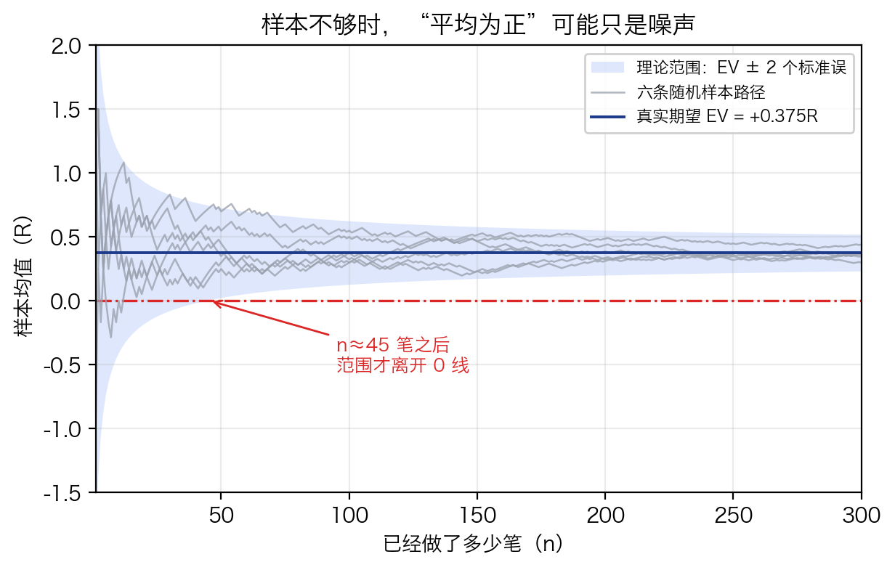
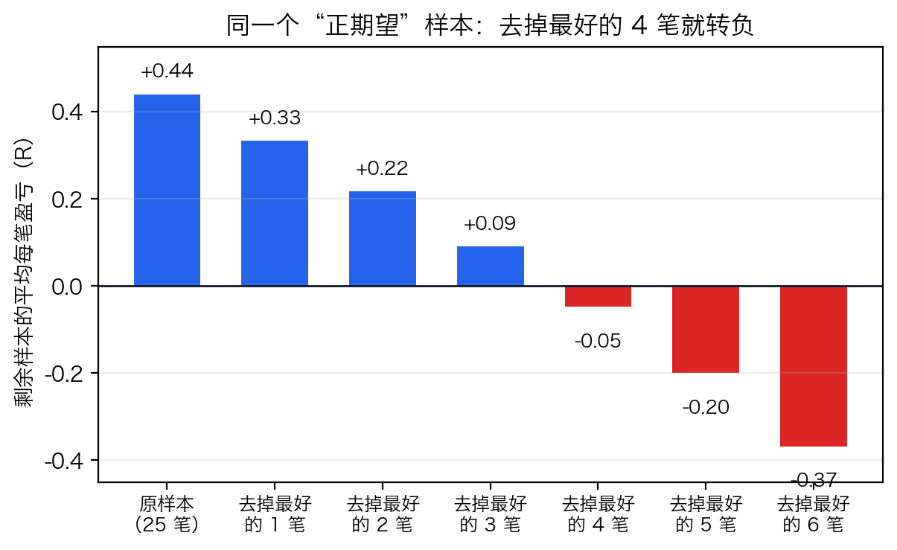
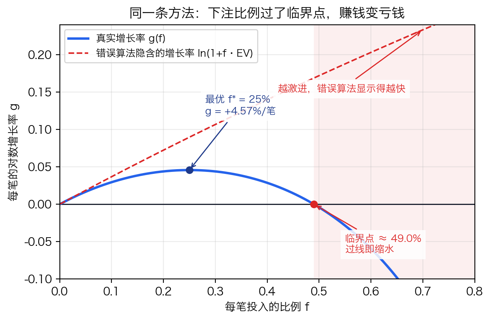
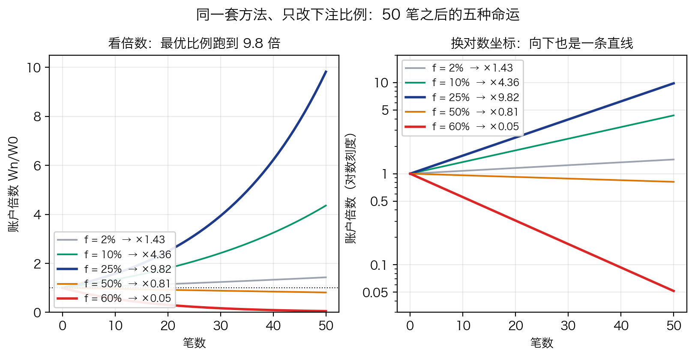
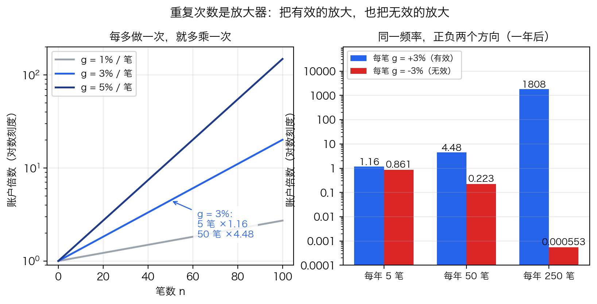

# 利滚利的三个开关，多数人只找到一个

> **阅读说明（三种读法，任选一种）**：① 只想知道结论——读每节开头的人话和每节末尾的「一句话」；② 想看数学——每节的「数学版」给了公式和推导要点；③ 想自己验一遍——附录 A 是完整推导，附录 B 是全部数字的复核表与复现脚本。五张图三种读法通用，建议都看一眼。

有件事，很多人做了很久也没想通：

**为什么有人能像滚雪球一样越滚越大、越滚越快；而大多数人滚了几年，还在原地打转，甚至越滚越小？**

运气？天赋？努力程度？都不是关键。

把「钱怎么越滚越快」拆开算一遍——它取决于三个开关：

**① 一个真的能赚钱的方法；**
**② 每笔不贪多；**
**③ 把有效的事重复够多次。**

先说结论：这三个开关，多数人只开得动第一个——而且严格说，很多人只是停在「在找」：知道要找一个能赚钱的方法，却还没把它验成真的。后两个反直觉得多，也几乎没人系统讲过——这篇就是来补这部分。

整篇文章其实只讲一行公式：

$$\frac{W_n}{W_0}\;\approx\;e^{\,n\cdot g},\qquad g=\mathbb{E}\big[\ln(1+fR)\big]$$

（$W_0$ 是开始时的本金，$W_n$ 是做完 $n$ 次之后的本金。）

看不懂公式不影响读下去，先认三个符号——三个开关就是这三个符号：

| 符号 | 是什么 | 归哪个开关管 |
|---|---|---|
| $g$ | 每做一次的**平均增长率**（对数口径） | 开关一：方法的质量 |
| $f$ | 每次投入的**比例** | 开关二：下注的尺度 |
| $n$ | 一共**做了多少次** | 开关三：重复的次数 |

这行公式读成中文就是：**账户的倍数 ≈ e 的「次数 × 每次增长率」次方。** 三个符号各就各位，钱才会越滚越快；任何一个不对劲，指数就失效——缩水、停滞、或者白忙。

> **边界说在前头**（这类话题最该说完整的一部分）：「越滚越快」只在 ①② 成立时成立——缺了它们，③ 反而会加速亏钱（第三节细说）。文中所有数字都是**公开示例参数的演算**，用来把结构讲清楚——不是任何实盘的记录，不是收益承诺，也不构成投资建议。

## 开关一：一个「真的能赚钱」的方法

「真的能赚钱」，不是某一笔赚了，也不是「听起来有道理」，而是：**长期、大样本看下来，平均每一次是正的。** 行话叫「正期望」，数学上写成 $\mathrm{EV}=\mathbb{E}[R]>0$。

这里的 $R$ 不用钱来记，而用**风险单位**——把「这一笔最多愿意亏的钱」当作 1 个单位：赢了 2 个风险单位就记 $R=+2$，亏满 1 个就记 $R=-1$。这样记的好处是：$R$ 只看方法的**质量**，与账户多大、每次下注多少都无关。

判断它，有三个常见错误：

- 用单笔手感判断——那多半是运气；
- 用入场规则判断——「胜率过半才出手」这类门槛只是纪律，它只告诉你**不出手**什么，不告诉你出手的能不能赚（门槛是准入线，不是水平线）；
- 用「最近好像不错」判断——样本太少，看什么都像信号。

### 数学版（可跳过）

**第一，把「平均」写出来。** 一个方法无非是「赢的时候赚多少、输的时候亏多少、各自多大概率」，平均每笔就是：

$$\mathrm{EV}=\mathbb{E}[R]=p\cdot R_W-q\cdot|R_L|$$

（$p$ 是胜率，$R_W$ 是赢时赚几个风险单位，$q=1-p$ 是败率，$|R_L|$ 是亏时亏几个风险单位。全文示例：$p=0.55$、$R_W=1.5$、$|R_L|=1$，算出来 $\mathrm{EV}=+0.375$。）

**第二，EV 不能凭感觉，要用样本估。** 两个量一起看：

$$\hat{\mathrm{EV}}_n=\frac{1}{n}\sum_{i=1}^{n}R_i,\qquad \mathrm{SE}=\frac{\sigma}{\sqrt{n}},\qquad t=\frac{\hat{\mathrm{EV}}_n}{\mathrm{SE}}=\frac{\hat{\mathrm{EV}}_n\sqrt{n}}{\sigma}$$

三行符号连起来读：**平均是正的**（分子）÷ **这个平均是几笔撑起来的**（分母）。$t$ 越大，越不像运气。反过来说——只要置信区间下界还压在 0 以下，就宁可信它是 0。**这就是「在找」和「验真」之间的分界线。**

要攒多少样本才够？粗略地说，让 $t$ 至少到 2，需要

$$n\ \gtrsim\ \frac{4\sigma^2}{\mathrm{EV}^2}$$

代入示例参数（$\sigma\approx1.24$）是**约 45 笔**。也就是说：一个真实存在的 +0.375R 优势，也要四十多笔才能在统计上站稳；样本不到这个量级，「我最近觉得它很准」都还只是噪声（图 1）。

**第三，「平均为正」还有两个坑。**

- **均值会被少数几笔拉高。** 赢的时候赢得大、输的时候亏得小（右偏分布）时，均值可以很好看，中位数却是负的——「平均赚」不等于「一半以上的次数在赚」。
- **「正」可能只靠少数几笔撑着。** 把最好的那几笔拿掉再看一遍——这叫稳健性检验，也是「这个平均到底被多少笔撑起来」最直接的做法（图 2）。



*图 1：真实期望只有 +0.375R，但样本少的时候，六条随机样本路径的「平均值」能从 −1R 晃到 +1.5R；约 45 笔之后，理论范围才离开 0 线。**早期看到的「很准」或「没用」，大多只是这笔数还没攒够。**（示意模拟：示例参数、每笔独立。）*



*图 2：一个人为构造的 25 笔样本（9 笔赢 +3R、16 笔亏 −1R），平均每笔 +0.44R，看着很赚钱；**把最好的 4 笔（16%）拿掉，平均就变成 −0.05R**——赚不赚钱全靠那几笔。正期望是真的，但脆弱。*

**一句话：没经过验证的，只能算「在找」；验证靠的不是感觉，是样本统计——平均为正，且这个「正」撑得住去掉几笔大赚。**

## 开关二：每笔不贪多

先给一个反直觉的事实：**就算方法真的能赚钱，下注太多，也会越做越亏。**

拿一组公开示例参数算一遍。假设有一套方法：

- 胜率 55%，赢的时候赚 1.5 个风险单位、输的时候亏 1 个风险单位；
- 平均每笔 = 0.55 × 1.5 − 0.45 × 1 = **+0.375 个风险单位**，是正的（就是上一节那套）。

再假设一个习惯：每做一笔，拿**当前本金的固定比例**去冒险——这就是「固定比例下注」。同一套方法，只改这个比例，做 50 笔之后：

| 每笔冒险 | 真实每笔增长 $g$ | 50 笔后（真实） | 错误算法说（每笔） |
|---|---|---|---|
| 2% | +0.72% | ×1.43（慢，但在涨） | +0.75% |
| 10% | +2.95% | ×4.36 | +3.75% |
| 25% | **+4.57%** | **×9.82（数学最优）** | +9.38% |
| 50% | **−0.41%** | **×0.81（反而缩水）** | +18.75% |
| 60% | −5.93% | ×0.05（快速缩水） | +22.50% |

方法没变、胜率没变，只因为下注比例过了头——**一个平均每笔赚钱的方法，被做成了不断亏钱的账户。**

为什么？两个原因。

**第一，复利是乘出来的，盈亏不对称。** 亏掉一半，要翻倍才能回本；先亏一半、再赚一半，账户只剩 0.75 倍。赚和亏轮流出现时，「亏」对「赚」的拖累比直觉大得多——同样的平均收益，波动越大，实际滚得越慢。这个拖累有确切的名字和公式，见下面的数学版。

**第二，有一个顺手的错误算法，会专门骗你往大里下。** 它会这样算：平均每笔赚 0.375 个单位，那每笔下注 60%，每笔不就赚 22.5%？——这个算法漏掉了波动，会算出一条永远向上的直线，把「越激进」显示成「越快」。真实情况是：60% 那一行，账户在缩水。更刺眼的对比如下——**同一个 60%，错误算法说 50 笔后是 ×25,516，真实是 ×0.05，差了约五十万倍。**

### 数学版（可跳过）

**第一步：单笔。** 设第 $i$ 笔冒险的比例为 $f$，风险敞口就是 $M_i=f\cdot W_{i-1}$；这笔赚亏 $R_i$ 个风险单位，于是盈亏 $=f\cdot W_{i-1}\cdot R_i$，账户递推为

$$W_i=W_{i-1}+f\,W_{i-1}R_i=W_{i-1}\,(1+fR_i)$$

（顺带一个漂亮的性质：单笔收益率 $=W_i/W_{i-1}-1=fR_i$，**与账户大小无关**——10 万和 100 万，每笔的刻度一样，这就是「固定比例」比「固定金额」干净的地方。）

**第二步：连乘。** 一笔一笔乘下去：

$$W_n=W_0\prod_{i=1}^{n}(1+fR_i)\qquad\Longrightarrow\qquad \text{累计收益率}=\prod_{i=1}^{n}(1+fR_i)-1$$

这是**精确式**：真实发生的复利就是这个乘积，没有任何近似。

**第三步：错在哪。** 有人把乘积直接换成幂：

$$W_n\ \overset{?}{\approx}\ W_0\,(1+f\,\mathrm{EV})^{n}$$

这个式子看起来特别顺眼：永远向上、越激进越快——而它是错的。把精确式两边取对数（乘法变加法）、再除以 $n$：

$$\frac{1}{n}\ln\frac{W_n}{W_0}=\frac{1}{n}\sum_{i=1}^{n}\ln(1+fR_i)\ \xrightarrow{\ n\to\infty\ }\ \mathbb{E}\big[\ln(1+fR)\big]=:g$$

（大数定律：样本平均趋于期望。所以**真实增长率是 $g=\mathbb{E}[\ln(1+fR)]$，不是 $f\cdot\mathrm{EV}$**。）

那 $g$ 和 $f\cdot\mathrm{EV}$ 差在哪？由 **Jensen 不等式**——对数函数是凹的，凹函数的「期望」不超过「期望的函数」：

$$\mathbb{E}\big[\ln(1+fR)\big]\ \le\ \ln\Big(\mathbb{E}\big[1+fR\big]\Big)=\ln(1+f\,\mathrm{EV})$$

等号**只在没有波动时**成立（每一笔都恰好赚 EV）。只要盈亏有波动，真实增长率就严格更小——这个差距叫**波动率拖累（volatility drag）**。

**第四步：把差距算出来。** 对小 $x$ 有泰勒展开 $\ln(1+x)\approx x-\frac{x^2}{2}$，取 $x=fR$：

$$g=\mathbb{E}\big[\ln(1+fR)\big]\ \approx\ \underbrace{f\cdot \mathrm{EV}}_{\text{算术增长}}\ -\ \underbrace{\frac{f^2}{2}\,\mathbb{E}[R^2]}_{\text{方差惩罚}}$$

**第一项是算术增长，第二项是方差惩罚。** 这就是「同样的平均收益，波动越大、真实复利越低」的数学来源：$g$ 在 $f^*$ 处见顶，往下走；错误算法只有第一项，所以它永远向上。

**第五步：最优比例与临界点。** 对 $f$ 求导，令导数为 0，得到增长最快的下注比例：

$$f^*\ \approx\ \frac{\mathrm{EV}}{\mathbb{E}[R^2]}\quad(\text{近似})$$

若每笔只有「赢、输」两种结果，还有不做近似的精确解：

$$f^*=\frac{pR_W-q\,|R_L|}{R_W\,|R_L|}=\frac{p}{|R_L|}-\frac{q}{R_W}$$

（这正是经典的**凯利公式**。代入示例：$f^*=0.55-0.45/1.5=25\%$，与表中「25% 最优」一致。）

**增长速度转负的临界点**由 $g=0$ 给出，在二阶近似下它恰好是最优值的两倍：

$$g>0\ \Longleftrightarrow\ f<\frac{2\,\mathrm{EV}}{\mathbb{E}[R^2]}\ \approx\ 2f^*\qquad(\text{近似})$$

示例参数下精确解是 $f_c\approx49.0\%$——**超过它，同样的方法、同样的胜率，账户长期必然缩水。** 这就是表里 50%、60% 两行变负的原因。（「两倍凯利」的这个近似有适用边界，附录 A.6 给了反例，别把它当无条件红线。）



*图 3：蓝线是真实的每笔增长率 $g(f)$——先升后降，在 25% 见顶、约 49% 处穿过零线；红线虚线是错误算法隐含的增长率——**它只会一路向上**。两张脸差在「方差惩罚」这一项上。*



*图 4：同一套方法，只改下注比例，50 笔之后的五种结局：2% 慢涨（×1.43）、10% 中速（×4.36）、25% 最快（×9.82）、50% 微跌（×0.81）、60% 快跌（×0.05）。右图换对数坐标后，曲线都是直线——**斜率就是每笔增长率 $g$；向下那条，斜率是负的。***

### 那到底下多少算「不贪」

数学上有一个最优比例（这套参数里是 25%），但**现实中没人用满**——因为你估计的 55%、1.5 这些数字本身有误差，误差会把「最优」变成「灾难」：$f^*$ 附近曲线是平的，稍微过一点就开始往下走，参数估错的代价不对称。常见做法是**分数凯利**：只用最优值的一部分，

$$f=\lambda f^*,\qquad \lambda\in\left[\tfrac14,\ \tfrac12\right]$$

先保证活得久，再谈快。

**一句话：下注的上限不是胆量，是数学。赚得稳（低方差）比赚得猛（高均值）更重要。**

## 开关三：把有效的事重复够多次

这条最简单，也最容易被误解。

先记住一个反常识的结论：**复利靠「做了多少次」，不靠「等了多久」。** 每做一次，账户才乘以一个数；空仓的时候什么都没发生——不赚不亏，也不「复利」。同样是 100 次，一年做完和五年做完，结果完全一样（前提是每笔的统计特征不变）。「长期主义」如果只剩下「等」，那它什么都没做。

数学上，时间只通过一个渠道进来：一段时间 $t$ 内能做多少次，取决于频率 $\nu$（比如每年做多少笔）：

$$n=\nu\cdot t\qquad\Longrightarrow\qquad \frac{W(t)}{W_0}\ \approx\ e^{\,n\,g}=e^{\,(\nu g)\,t}$$

也就是说：**年化对数增长率 = 频率 × 每笔增长率**。复利是被「做了一次又一次」这个事件驱动的，日历时间本身不产生任何东西。

再看次数的威力：假设每笔的增长率 $g=3\%$（示意数字），做 5 次是 ×1.16，做 50 次是 ×4.48——每上一个台阶，结果都按乘法拉开；而频率把这件事再放大：每笔 3%、一年做 250 笔，一年后是 ×1808（仍是示意数字）——**这也是为什么「多做」既有吸引力、又危险。**



*图 5：左图——同样的每笔增长率，重复次数每加一段，倍数就再乘一次（对数坐标下是直线）；右图——同一频率放到正负两个方向上，结果是对称的放大：有效的被放大，无效的也被放大。*

### 但这一条有个必须说清楚的前提

**③ 是放大器，不是发动机。**

放大器把正期望放大，也把负期望放大。前两个开关不成立的时候——方法没验过、下注又过头——「多做」不会让你更快变富，只会让你更快亏完：**负的东西，做得越多错得越快**（$g<0$ 时 $e^{ng}$ 随 $n$ 衰减，频率 $\nu$ 越大衰减越猛）。

所以准确的说法不是「多做」，而是「**在 ①② 成立的前提下**，把已被验证有效的事，重复够多次」。为了凑次数去做不该做的动作，是往乘法链里塞负数。等不到好机会的时候，空仓不是损失——不赚不亏，只是暂停。

**一句话：时间不是复利的原因，只是复利的容器；决定速度的是「做了多少次」。**

## 三个开关合起来

| 开关 | 对应的数学量 | 决定什么 |
|---|---|---|
| ① 真方法 | $\mathrm{EV}=\mathbb{E}[R]>0$，且统计上站得住 | 方向——$g$ 的符号从哪来 |
| ② 不贪多 | $f\le f^*$，实践上取分数凯利 | 生死——$g$ 是正还是负 |
| ③ 重复够多 | $n=\nu t$，在 ①② 成立后尽可能大 | 速度——指数上的乘数 |

回头看总公式 $\dfrac{W_n}{W_0}\approx e^{ng}$：**$g$ 由 ① 和 ② 共同决定**（$g\approx f\cdot\mathrm{EV}-\frac{f^2}{2}\mathbb{E}[R^2]$），**$n$ 由 ③ 决定**。三个都开着，钱才会越挣越多、越挣越快；只开一个——尤其是只开着第一个——就是「一直在找方法、却一直没滚起来」的原因。而现在，另外两个长什么样你也见过了。

最后，把话说完整：

- 文中所有数字都是**公开示例参数的演算**，用来讲结构——不是收益承诺；「越滚越快」只在 ①② 成立时成立；
- 你的方法到底有没有正期望，只能用自己的样本去验证，别人给不了；样本不够时，保守读；
- 复利模型假设「每笔最多亏 1 个风险单位」，现实里可能跳空、滑点、亏损超预期，实际分布比模型更野——留足余量；
- 这不是投资建议。而且换个场景也一样：任何「可重复、每次投入有限、长期平均为正」的事——做内容、做产品、练手艺——快慢都由这三个开关决定。

不妨拿自己的账对一遍：**平均每一次，是赚是亏（$g$ 的符号）？每次投入多大（$f$ 过线没有）？有没有在重复做那件已经验证对的事（$n$ 够不够）？**

这三个答案，就是你「钱滚得快慢」的全部原因。

---

## 附录 A：完整推导（给想深挖的读者）

### A.1 符号与前提

| 符号 | 含义 |
|---|---|
| $W_0,\ W_i$ | 初始本金、第 $i$ 笔之后的账户 |
| $f$ | 每笔冒险的比例（按笔前账户计，$M_i=fW_{i-1}$） |
| $R_i$ | 第 $i$ 笔的盈亏，以风险单位计（$R_i=P_i/M_i$） |
| $p,\ q$ | 胜率、败率（$q=1-p$） |
| $R_W,\ \lvert R_L\rvert$ | 赢时赚几个风险单位、亏时亏几个风险单位（均取正数） |
| $\mathrm{EV},\ \sigma^2$ | $\mathbb{E}[R]$、$\mathrm{Var}(R)$ |
| $g$ | 每笔的对数增长率 $\mathbb{E}[\ln(1+fR)]$ |
| $n,\ \nu,\ t$ | 笔数、频率（笔/年）、时间（年） |

模型前提：① 每笔风险按笔前账户的固定比例 $f$ 确定（账户涨，下一笔的风险敞口跟着涨；账户跌，跟着缩）；② 各笔的 $R_i$ 独立同分布，期望 $\mathrm{EV}$、方差 $\sigma^2$；③ 单笔亏损以风险单位计（现实差异见正文结尾第 3 条）；④ $f|R_L|<1$（单笔最大亏损不超过账户，否则对数无定义、一次就出局）。

### A.2 单笔递推与连乘（精确式）

单笔：$W_i=W_{i-1}(1+fR_i)$；连乘 $n$ 笔：

$$\frac{W_n}{W_0}=\prod_{i=1}^{n}(1+fR_i)$$

**这是精确式**（前提：每笔亏损不超过账户，$1+fR_i>0$），是后面一切近似的基准。

### A.3 对数化与大数定律

两边取对数，乘积变求和；除以 $n$ 后用大数定律（$R_i$ 独立同分布、$\mathbb{E}\ln(1+fR)$ 存在）：

$$\frac{1}{n}\ln\frac{W_n}{W_0}=\frac{1}{n}\sum_{i=1}^{n}\ln(1+fR_i)\ \xrightarrow{\ \text{a.s.}\ }\ g=\mathbb{E}\big[\ln(1+fR)\big]$$

于是 $\dfrac{W_n}{W_0}\approx e^{ng}$——这就是全文总公式的来源。**注意：是 $g$，不是 $f\cdot\mathrm{EV}$。**

### A.4 Jensen 不等式：为什么乘积不能换成幂

$\ln$ 是凹函数，由 Jensen 不等式：

$$\mathbb{E}\big[\ln(1+fR)\big]\ \le\ \ln\big(\mathbb{E}[1+fR]\big)=\ln(1+f\,\mathrm{EV})$$

即 $e^{g}\le 1+f\,\mathrm{EV}$，等号当且仅当 $R$ 无方差（每笔都恰好赚 EV）。

**严谨口径（两个层次，别混用）**：

- **有限 $n$**：由 AM-GM（几何均值 ≤ 算术均值），$\left(\prod_{i\le n}(1+fR_i)\right)^{1/n}\le 1+f\bar R_n$（$\bar R_n$ 为前 $n$ 笔的样本均值）——这一步与总体 EV 无关；
- **渐近**：再由大数定律 $\bar R_n\to \mathrm{EV}$，才得到 $\lim_{n\to\infty}\left(\prod_{i\le n}(1+fR_i)\right)^{1/n}=e^{g}\le 1+f\,\mathrm{EV}$（几乎必然）。

也就是说，Jensen 给的不等式是**渐近意义上**的；有限 $n$ 时存在反例（如 EV=0 的 ±1 等概率赌局，恰好全赢的样本里乘积大于 1）。只要 $\sigma^2>0$，缺口就为正，且随 $n$ 增大稳定下来。

### A.5 泰勒展开：波动率拖累

对 $|x|\ll1$，$\ln(1+x)=x-\frac{x^2}{2}+\frac{x^3}{3}-\cdots\approx x-\frac{x^2}{2}$。取 $x=fR$ 并取期望：

$$g\approx f\,\mathrm{EV}-\frac{f^2}{2}\mathbb{E}[R^2]=f\,\mathrm{EV}-\frac{f^2}{2}\big(\sigma^2+\mathrm{EV}^2\big)$$

三项分别是：算术增长、方差惩罚、均值自身的二阶修正（示例参数下，$f=25\%$ 时精确 $g=+4.569\%$、近似 $+4.102\%$，偏差来自 $|fR|$ 不够小）。这解释了「同样的 EV，低方差策略复利更高」。

### A.6 增长条件、凯利最优与「两倍凯利」的边界

**增长条件**：$g>0\Leftrightarrow$（二阶近似下）$f<\dfrac{2\,\mathrm{EV}}{\mathbb{E}[R^2]}$；记精确零点为 $f_c$。

**凯利最优（两结果精确解）**：$g(f)=p\ln(1+fR_W)+q\ln(1-f|R_L|)$，求导置零：

$$\frac{dg}{df}=\frac{pR_W}{1+fR_W}-\frac{q|R_L|}{1-f|R_L|}=0\ \Longrightarrow\ f^*=\frac{p}{|R_L|}-\frac{q}{R_W}$$

整理过程：$pR_W(1-f|R_L|)=q|R_L|(1+fR_W)$，展开移项得 $fR_W|R_L|(p+q)=pR_W-q|R_L|$。

**「两倍凯利」的适用边界**：$f_c\approx2f^*$ 只是**抛物线（二阶泰勒）近似**的结论。当 $|f^*R_W|$ 与 $f^*|R_L|$ 都远小于 1 时它接近精确（本文主例偏差约 2%：精确 $f_c=0.4901$，$2f^*=0.50$）；一旦这两个量不小，偏差可以到方向性失准。实算反例：

> $p=0.25$、$R_W=3$、$|R_L|=0.5$（小止损、大赔率的区制）：
> $\mathrm{EV}=+0.375$、$f^*=0.25$、$2f^*=0.50$，但 $g(0.50)=+1.33\%$ 仍为正，真实临界点 $f_c\approx56.0\%$。
> 此时 $|f^*R_W|=0.75$ 不满足「远小于 1」，近似失效——**用两倍凯利当红线之前，先实算 $g(f)$。**

### A.7 时间与频率

时间本身不进入增长率：$n$ 笔的结果只由 $n$ 决定（$\frac{W_n}{W_0}\approx e^{ng}$），日历时间只决定能做多少笔。以频率 $\nu$（笔/年）计，$n=\nu t$，代入得

$$\frac{W(t)}{W_0}\approx e^{\,\nu g\,t}$$

即年化对数增长率 $=\nu g$。$g$ 的符号是生死线：$g<0$ 时频率 $\nu$ 越大衰减越猛（放大器对两个方向对称，见图 5 右）。

## 附录 B：数字复核表与复现

### B.1 全文数字一览（示例参数：胜率 55%、赢 +1.5R、亏 −1R）

| 量 | 值 | 说明 |
|---|---|---|
| $\mathrm{EV}$ | +0.375R | $0.55\times1.5-0.45\times1$ |
| $\mathbb{E}[R^2]$ | 1.6875 | $0.55\times1.5^2+0.45\times1^2$ |
| $\sigma$ | ≈1.2437 | $\sqrt{1.6875-0.375^2}$ |
| $t=2$ 所需样本 | ≈44 笔（t 分布细算 45 笔） | $4\sigma^2/\mathrm{EV}^2$ |
| 精确凯利 $f^*$ | 25% | $0.55-0.45/1.5$ |
| 近似凯利 | 22.2% | $\mathrm{EV}/\mathbb{E}[R^2]$ |
| 精确临界点 $f_c$ | 49.0% | 数值解 $g(f)=0$ |
| $g$（$f$=2%/10%/25%/50%/60%） | +0.717% / +2.946% / +4.569% / −0.413% / −5.931% | 精确式 |
| 50 笔倍数（同上顺序） | ×1.43 / ×4.36 / ×9.82 / ×0.81 / ×0.05 | $e^{50g}$ |
| 错误算法说 | ×1.45 / ×6.30 / ×88.3 / ×5,391 / ×25,516 | $(1+f\mathrm{EV})^{50}$ |
| 示意样本（9 赢 +3R、16 亏 −1R） | 均值 +0.44R；去掉最好的 4 笔 → −0.05R | 图 2 |
| $g=3\%$ 示意 | 5 次 ×1.16；50 次 ×4.48；每年 250 次 ×1808（一年后） | 图 5 |

### B.2 复现

全部图表与数字由仓库内脚本生成，标准库 + numpy + matplotlib：

```bash
python3 docs/articles/charts.py
```

脚本末尾会打印上表数字与五张图（输出到 `docs/articles/img/`）。

---

*本文所用示例参数为公开演算示例，不代表任何实际策略、实盘记录或收益承诺，亦不构成投资建议。*
